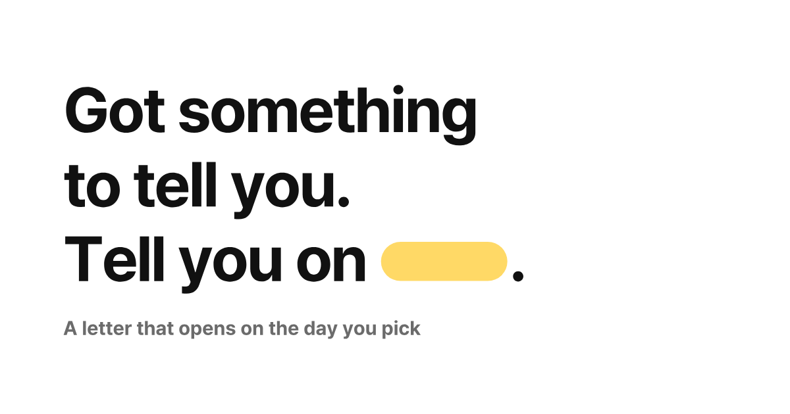

# Tell You Later

[한국어](README.md) | English

Send a letter as a link that only opens on the date you choose.

👉 [Write one now](https://tell-you-later.0jin.app/en/)

<!-- TODO: GIF (write a letter → locked screen → opened screen) -->

## What is it?

A letter you write now that opens later. Pick a date, write your letter, and you get a link.
Until that date, the person you send it to can't read what's inside.
Opening the link shows only a teaser — "Got something to tell you. Tell you on Jan 1." — and when the time comes, the letter opens.
No sign-up, no app to install.

## Ideas

- A letter to yourself, one year from now
- A birthday message that opens at midnight
- A New Year's greeting that opens at 12:00 AM on January 1
- A letter for a graduation, a homecoming, or an anniversary

## Features

- **10 themes** — DM, Text, Lock screen, Queue, Player, Fortune cookie, Book, Redacted, Airmail, Blessings
- **Preview before sending** — see exactly what the recipient will see, with your own letter.
- **Choose when it opens** — New Year's midnight, one year from now, or any date and time you like
- **Save to calendar** — add the opening date to Google Calendar or your device's calendar (.ics).
- **English / 한국어** — letters written in English show the recipient's screen in English too.

## Can it really not be opened early?

Really. Not by the person who made the link, and not by us.

- Your letter is never stored on a server. It's encrypted in your browser and lives only inside the link.
- It's locked with a key that is only published at the opening time, so nobody can unlock it before then.
  The key is released on schedule by a public network run jointly by several independent organizations.
  (For the technical details: [drand timelock](https://drand.love))
- If you lose the link, the letter can't be recovered, so keep it somewhere safe.

## FAQ

**What if the recipient forwards the link?**
The link is the letter. Anyone who has it can read the letter once the opening date has passed. Before that date, it won't open for anyone.

**Can I edit or cancel a letter after sending it?**
No. Since nothing is stored on a server, a link you've sent can't be changed or taken back. To change something, write a new letter and send it again.

**Will it still open years from now?**
Yes. Links are built to keep working for years. As long as the drand network that publishes the keys keeps running, the letter opens on time.

**Can I send it through any messaging app?**
Yes — iMessage, WhatsApp, Instagram DMs, or anywhere you can share a link.
Very long letters make very long links, which some apps may cut off. You'll get a warning when the link is created if that might happen, so check that the link opens after sending it.

**How long can a letter be?**
Up to 2,000 characters.

## Contact

[contact@0jin.app](mailto:contact@0jin.app)

---

For development and deployment, see the [developer docs](docs/DEVELOPMENT.md) (Korean).
