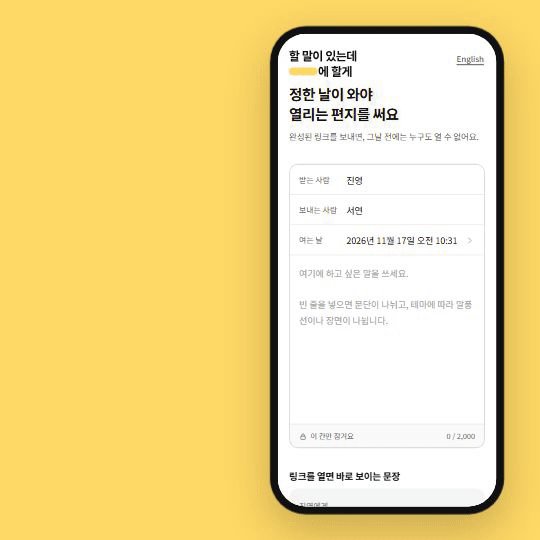

# 할 말이 있는데 나중에 할게

한국어 | [English](README.en.md)

정한 날짜가 되어야만 열리는 편지를 링크로 보내세요.

👉 [바로 써보기](https://tell-you-later.0jin.app)

## 어떤 서비스인가요?

지금 쓰고, 나중에 열리는 편지예요. 날짜를 정해 편지를 쓰면 링크가 만들어지고,
받는 사람은 그 날짜가 되기 전까지 내용을 볼 수 없어요.
링크를 열면 "할 말이 있는데 ○월 ○일에 할게"라는 예고만 보이고, 그 시각이 되면 편지가 열려요.
가입도, 앱 설치도 필요 없어요.

## 이렇게 써보세요

- 1년 뒤의 나에게
- 친구 생일 0시에 열리는 축하 메시지
- 새해 0시에 열리는 연하장
- 전역·졸업·결혼기념일에 열리는 편지

## 주요 기능

- **테마 12종** — DM, 문자, 잠금화면, 대기열, 플레이어, 포춘쿠키, 책 한 권, 가려진 글, 항공 봉투, 좋은 하루, 결재 공문, 군대 보고서
- **보내기 전에 미리보기** — 받는 사람에게 보일 화면을 내 편지로 미리 볼 수 있어요.
- **여는 날 고르기** — 새해 0시, 1년 뒤 지금, 또는 원하는 날짜와 시각
- **캘린더에 저장** — 여는 날을 구글 캘린더나 기기 캘린더(.ics)에 넣어 둘 수 있어요.
- **한국어 / English** — 영어로 쓰면 받는 사람 화면도 영어로 보여요.

## 정말 날짜 전에는 못 여나요?

네. 링크를 만든 사람도, 이 사이트를 만든 저희도 열 수 없어요.

- 편지는 서버에 저장되지 않아요. 브라우저에서 암호화된 채로 링크 안에만 들어 있어요.
- 개봉 시각이 되어야 공개되는 열쇠로 잠겨 있어서, 그 전에는 누구도 풀 수 없어요.
  이 열쇠는 여러 기관이 함께 운영하는 공개 네트워크가 정해진 시각에 내놓아요.
  (기술적으로 궁금하다면: [drand 타임락](https://drand.love))
- 링크를 잃어버리면 복구할 수 없으니 잘 보관해 주세요.

## 자주 묻는 질문

**링크를 받은 사람이 다른 사람에게 전달하면?**
링크가 곧 편지예요. 링크를 가진 사람은 누구든 여는 날 이후에 편지를 읽을 수 있어요. 여는 날 전에는 누구에게 전달돼도 열리지 않아요.

**보낸 편지를 고치거나 취소할 수 있나요?**
아니요. 서버에 저장하지 않기 때문에 이미 보낸 링크는 바꾸거나 거둘 수 없어요. 고치고 싶다면 새로 써서 다시 보내 주세요.

**몇 년 뒤에도 열리나요?**
네. 이미 보낸 링크는 몇 년 뒤에도 열리도록 만들었어요. 열쇠를 내놓는 drand 네트워크가 운영되는 한 정해진 시각에 열 수 있어요.

**카카오톡으로 보내도 되나요?**
네. 카카오톡, 인스타그램 DM, 문자 등 링크를 보낼 수 있는 곳이면 어디든 괜찮아요.
다만 편지가 아주 길면 링크도 길어져서 메신저에 따라 중간에 잘릴 수 있어요. 이럴 땐 링크를 만들 때 알려 드리니, 보낸 뒤 링크가 잘 열리는지 확인해 주세요.

**편지는 얼마나 길게 쓸 수 있나요?**
2,000자까지 쓸 수 있어요.

## 문의

[contact@0jin.app](mailto:contact@0jin.app)

---

개발 및 배포 방법은 [개발 문서](docs/DEVELOPMENT.md)를 참고하세요.
